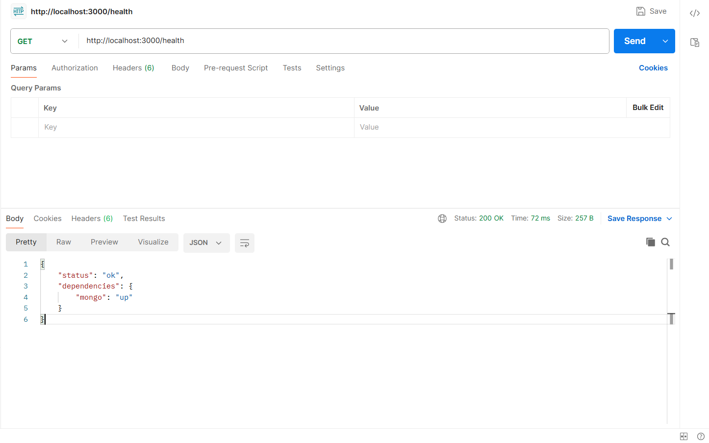
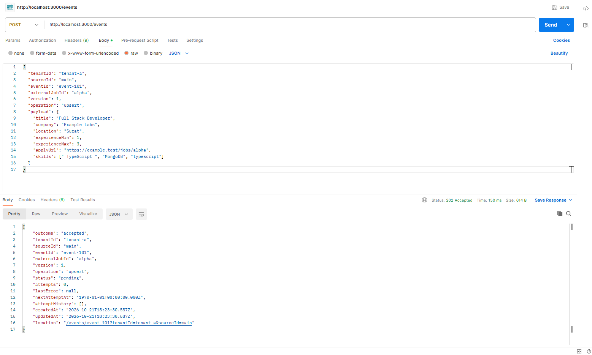
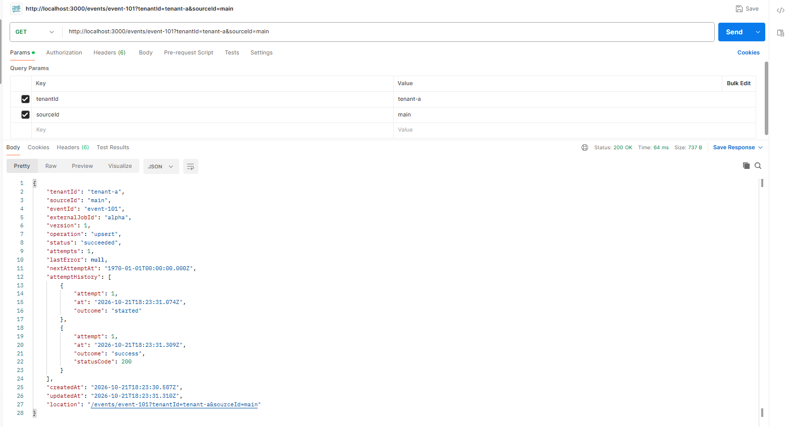
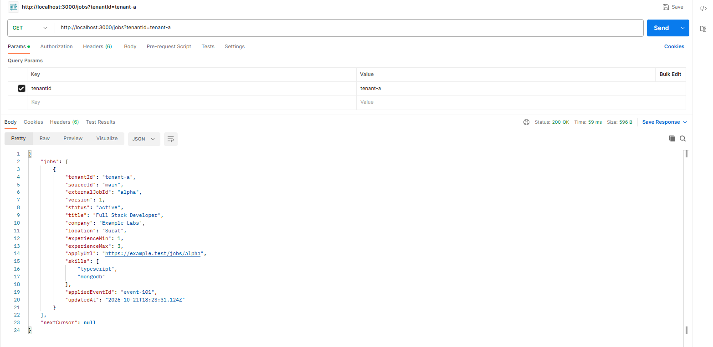
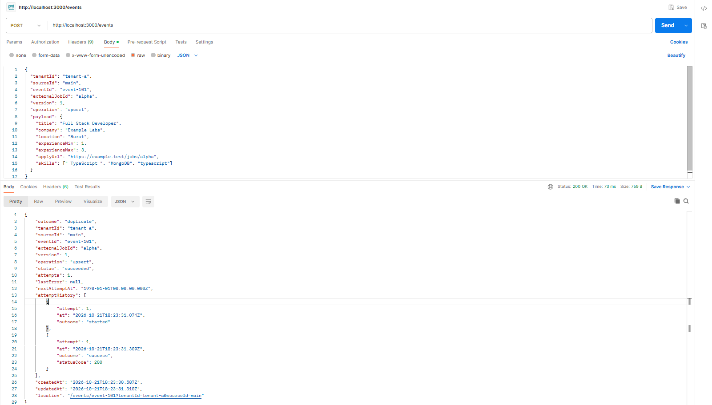
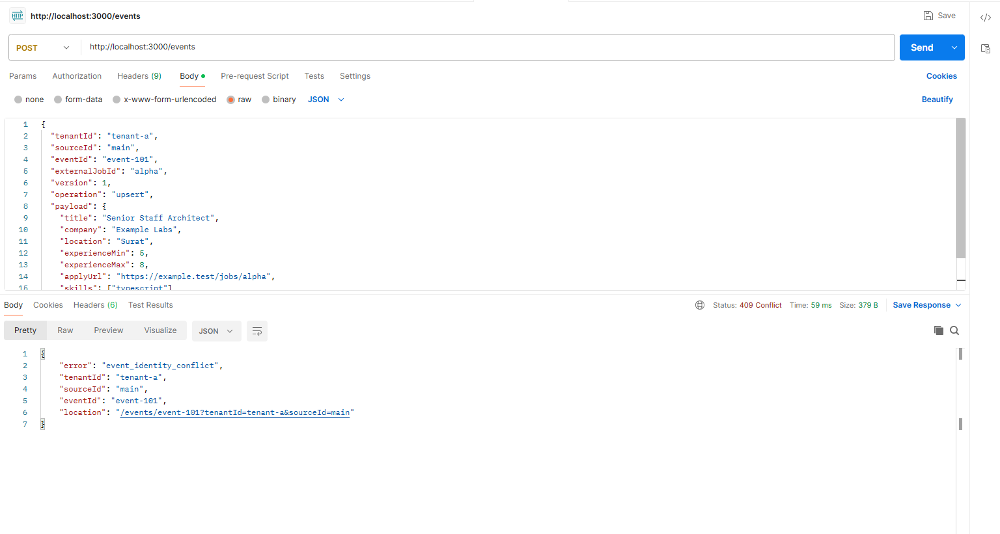
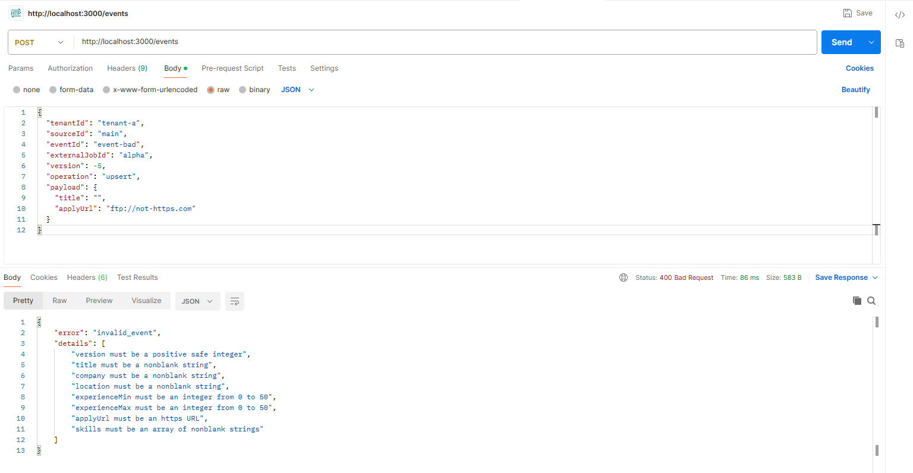
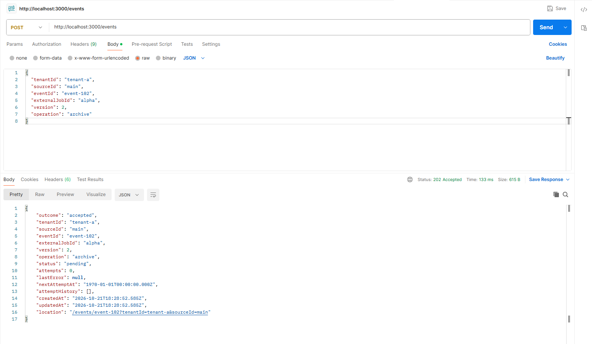
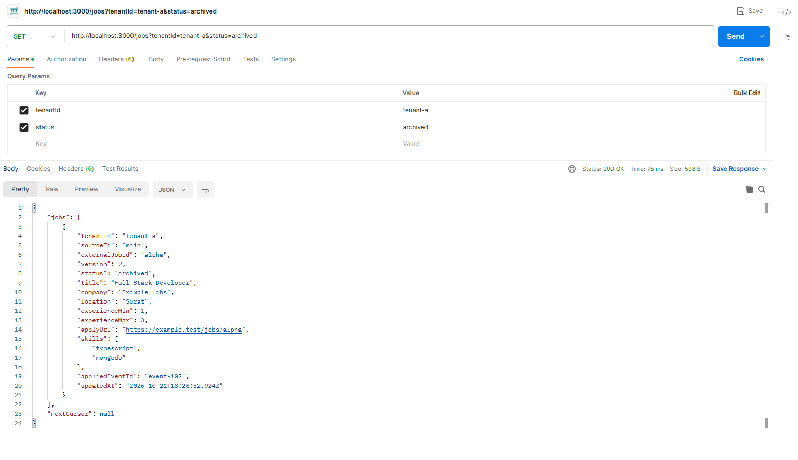
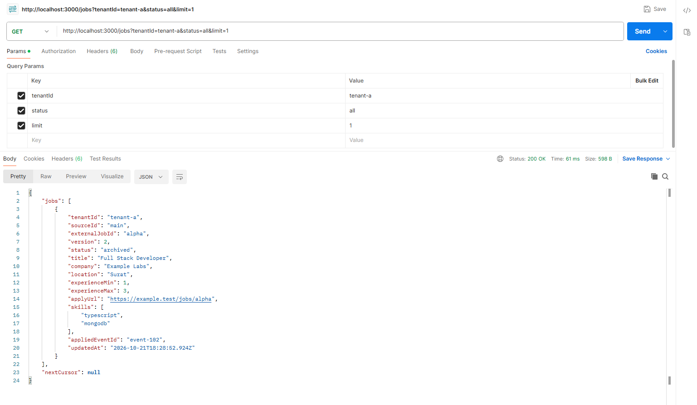

# 🚀 Reliable Job-Feed Ingestion Service

> A high-performance, asynchronous event-driven backend service built with **Node.js 22**, **TypeScript**, and **MongoDB**. Designed for durable ingestion, strict idempotency, version monotonicity, and distributed crash recovery without external message brokers.

---

## 📌 Table of Contents

- [Architecture Overview](#-architecture-overview)
- [Key Features](#-key-features)
- [Folder Structure](#-folder-structure)
- [Prerequisites &amp; Quick Start](#-prerequisites--quick-start)
- [API Reference](#-api-reference)
  - [1. Health Check (`GET /health`)](#1-health-check-get-health)
  - [2. Ingest Event (`POST /events`)](#2-ingest-event-post-events)
  - [3. Event Status (`GET /events/:eventId`)](#3-event-status-get-eventseventid)
  - [4. List Jobs (`GET /jobs`)](#4-list-jobs-get-jobs)
- [Visual API Verification (Postman Screenshots)](#-visual-api-verification-postman-test-suite)
- [Worker Architecture &amp; Concurrency](#-worker-architecture--concurrency)
- [Testing &amp; Verification](#-testing--verification)
- [Configuration Reference](#-configuration-reference)
- [Documentation Deliverables](#-documentation-deliverables)
- [Author Note](#-thank-you)

---

## 🏗️ Architecture Overview

The system decouples fast HTTP event ingestion from background processing. Incoming job events are validated, canonicalized, and durably persisted to an `events` collection before receiving immediate acceptance. A pool of distributed workers competes for pending work items using atomic lease locks directly on MongoDB.

---

## ✨ Key Features

- **Durable Acceptance**: `POST /events` persists the event to disk before responding with `202 Accepted` and a `Location` header. Zero synchronous external dependencies during ingestion.
- **Strict Idempotency & Replay Safety**:
  - Exact identical re-transmissions return `200 OK` without creating duplicate work items (JSON keys are canonicalized; key order is ignored, array order preserved).
  - Reusing an `eventId` with conflicting content returns `409 Conflict`.
  - Malformed payloads return `400 Bad Request` without reserving the event ID.
- **Version Monotonicity**: The greatest successfully processed version determines current job state. Delayed or out-of-order lower versions are safely handled as no-ops.
- **Archive Tombstones**: `operation: "archive"` transitions jobs to `archived` and preserves versioned tombstones so delayed older updates cannot revive deleted jobs.
- **Distributed Crash Recovery**: Workers claim work items using atomic `findOneAndUpdate` with lease timeouts (`lockedUntil`). If a worker dies mid-task, another worker recovers the expired lease automatically without duplicating external side effects.
- **Deterministic Cursor Pagination**: `GET /jobs` uses base64-encoded composite cursor keys `(tenantId, sourceId, externalJobId)` to ensure stable pagination that never skips or repeats items when jobs change between pages.
- **Multi-Tenant Isolation**: Compound database indexes ensure strict isolation across tenants and source feeds.

---

## 📁 Folder Structure

The project follows a clean, modular MVC-style architecture:

```
src/
├── index.ts                     # Main entry point (connects DB & starts HTTP server)
├── app.ts                       # Express setup & route mounting
├── config.ts                    # Strongly-typed environment configuration
├── types.ts                     # Domain TypeScript models & data contracts
│
├── routes/                      # Route declarations
│   ├── health.routes.ts         # GET /health
│   ├── event.routes.ts          # POST /events, GET /events/:eventId
│   └── job.routes.ts            # GET /jobs
│
├── controllers/                 # HTTP parsing & status code dispatching
│   ├── health.controller.ts     # Health status handler
│   ├── event.controller.ts      # Event ingestion & lookup handlers
│   └── job.controller.ts        # Jobs listing handler with query validation
│
├── services/                    # Core business logic
│   ├── event.service.ts         # Ingestion, deduplication & conflict checking
│   └── job.service.ts           # Job read-model querying & cursor pagination
│
├── db/                          # Database connection & projections
│   ├── mongo.ts                 # MongoDB connection, collections, and compound indexes
│   └── projection.ts            # Job read-model projections (upsert, archive, tombstone)
│
├── worker/                      # Background processing & queue workers
│   ├── worker.ts                # Standalone worker process entry point
│   ├── workers.ts               # Worker supervisor & concurrent loop manager
│   ├── processor.ts             # Atomic lease claim, upstream provider call, backoff
│   ├── runtime.ts               # File provider & worker lifecycle hooks
│   └── provider.ts              # Upstream provider client & retry simulator
│
├── utils/                       # Shared utility functions
│   ├── asyncRoute.ts            # Wrapper for async Express route error handling
│   ├── canonicalize.ts          # Deterministic JSON canonicalization
│   ├── cursor.ts                # Base64 cursor encoding and decoding
│   ├── format.ts                # Public API response formatting
│   ├── queryString.ts           # Query string extraction & safety checks
│   ├── paths.ts                 # Project directory resolution
│   ├── listen.ts                # HTTP server port listener helper
│   ├── sleep.ts                 # Non-blocking delay helper
│   └── validate.ts              # Input validation and field normalization
│
└── scripts/                     # Standalone CLI tools & test scripts
    ├── demo.ts                  # Fixture scenario runner
    ├── load.ts                  # Concurrency & load benchmark runner
    └── scenario-runner.ts       # Fixture execution engine
```

---

## ⚡ Prerequisites & Quick Start

### Prerequisites

- **Node.js**: v22.0.0 or higher
- **MongoDB**: Local MongoDB instance (or Docker) or MongoDB Atlas connection URL

### 1. Installation

```bash
# Clone the repository
git clone <repo-url>
cd job-feed-ingestion

# Install dependencies
npm install
```

### 2. Start MongoDB with Docker

Docker Compose starts only the database. The API runs on the machine with `npm run dev`.

```bash
docker compose up -d
```

`docker-compose.yml` maps `27018:27017`. The number on the left, **27018**, is the port on your computer. The number on the right, **27017**, is MongoDB's port inside the container. The app must connect to **27018**.

Stop the database with `docker compose down`. That keeps the saved data. `docker compose down -v` deletes it.

### 3. Environment Configuration

Copy `.env.example` to `.env`:

```bash
cp .env.example .env
```

`.env.example` already points at the Docker host port:

```bash
MONGO_URL=mongodb://127.0.0.1:27018/jobfeed
```

### 4. Run the Development Server

```bash
npm run dev
```

The server will start at `http://127.0.0.1:3000`. `GET /health` returns `{"status":"ok","dependencies":{"mongo":"up"}}` when the API can reach this Docker database.

---

## 📖 API Reference

### 1. Health Check (`GET /health`)

Returns service and database readiness.

```bash
curl -X GET "http://localhost:3000/health"
```

**Response (`200 OK`)**:

```json
{
  "status": "ok",
  "dependencies": {
    "mongo": "up"
  }
}
```

---

### 2. Ingest Event (`POST /events`)

Accepts one JSON event for ingestion.

```bash
curl -i -X POST "http://localhost:3000/events" \
  -H "Content-Type: application/json" \
  -d '{
    "tenantId": "tenant-a",
    "sourceId": "main",
    "eventId": "evt-101",
    "externalJobId": "alpha",
    "version": 1,
    "operation": "upsert",
    "payload": {
      "title": "Full Stack Developer",
      "company": "Example Labs",
      "location": "Surat",
      "experienceMin": 1,
      "experienceMax": 3,
      "applyUrl": "https://example.test/jobs/alpha",
      "skills": [" TypeScript ", "MongoDB", "typescript"]
    }
  }'
```

**Status Codes**:

- `202 Accepted`: New event durably recorded. Includes `Location: /events/:eventId?...` header.
- `200 OK`: Exact identical replay (same identity and canonical payload). No duplicate work created.
- `409 Conflict`: Event ID already exists with different payload content.
- `400 Bad Request`: Input validation failed (event ID not reserved).

---

### 3. Event Status (`GET /events/:eventId`)

Inspects the processing state of an event.

```bash
curl -X GET "http://localhost:3000/events/evt-101?tenantId=tenant-a&sourceId=main"
```

**Response (`200 OK`)**:

```json
{
  "tenantId": "tenant-a",
  "sourceId": "main",
  "eventId": "evt-101",
  "status": "processed",
  "attempts": 1,
  "lastError": null
}
```

_Lifecycle Statuses: `pending` ➔ `processing` ➔ `processed` (or `failed` if retries exhausted)._

---

### 4. List Jobs (`GET /jobs`)

Retrieves the latest projected jobs for a tenant with deterministic cursor-based pagination.

```bash
curl -X GET "http://localhost:3000/jobs?tenantId=tenant-a&status=active&limit=20"
```

**Query Parameters**:

- `tenantId` (_required_): Target tenant scope.
- `sourceId` (_optional_): Filter by specific feed source.
- `status` (_optional_): `active` (default), `archived`, or `all`.
- `limit` (_optional_): Page size (1 to 100, default 20).
- `cursor` (_optional_): Opaque base64 token for fetching subsequent pages.

**Response (`200 OK`)**:

```json
{
  "jobs": [
    {
      "sourceId": "main",
      "externalJobId": "alpha",
      "version": 1,
      "status": "active",
      "title": "Full Stack Developer",
      "company": "Example Labs",
      "location": "Surat",
      "experienceMin": 1,
      "experienceMax": 3,
      "applyUrl": "https://example.test/jobs/alpha",
      "skills": ["typescript", "mongodb"],
      "updatedAt": "2026-10-21T18:00:00.000Z"
    }
  ],
  "nextCursor": null
}
```

---

## 📸 Visual API Verification (Postman Test Suite)

All core API endpoints, idempotency guarantees, schema validations, and lifecycle states were manually and automatically verified via Postman against the live server. Below are the actual execution screenshots from `Assets/Test/`:

### 1. Health Check (`GET /health`) ➔ `200 OK`

Verifies database connectivity and service readiness.


---

### 2. Ingest Valid Event (`POST /events`) ➔ `202 Accepted`

Event is durably persisted to the database; returns `202 Accepted` with a `Location` header.


---

### 3. Check Event Processing Status (`GET /events/:eventId`) ➔ `200 OK`

Shows worker processing outcome (`status: "succeeded"`, 1 attempt, timestamps).


---

### 4. Query Active Projected Jobs (`GET /jobs?tenantId=tenant-a`) ➔ `200 OK`

Returns current projection of active jobs with skills normalized and `appliedEventId` tracked.


---

### 5. Idempotent Exact Replay (`POST /events`) ➔ `200 OK`

Re-submitting the exact same event returns `200 OK` (`outcome: "duplicate"`) without duplicating background worker items.


---

### 6. Conflicting Payload on Reused ID (`POST /events`) ➔ `409 Conflict`

Reusing an existing `eventId` with a different payload hash triggers an immediate `409 Conflict` (`event_identity_conflict`).


---

### 7. Strict Schema Validation (`POST /events`) ➔ `400 Bad Request`

Negative versions, non-HTTPS URLs, and invalid salaries are caught immediately (`event_id` is never reserved).


---

### 8. Ingest Archive Operation (`POST /events`) ➔ `202 Accepted`

Submitting an `archive` action for Version 2 is accepted for asynchronous tombstone processing.


---

### 9. Query Filtered Archived Jobs (`GET /jobs?status=archived`) ➔ `200 OK`

Verifies that the job projection transitioned to `status: "archived"` with Version 2 tombstone.


---

### 10. Filter All Jobs with Keyset Pagination (`GET /jobs?status=all&limit=1`) ➔ `200 OK`

Demonstrates keyset cursor pagination with page size capping and status filtering.


---

## ⚙️ Worker Architecture & Concurrency

- **Atomic Queue Claims**: Workers poll the `events` collection using `findOneAndUpdate` matching `status: "pending"` or expired leases (`lockedUntil < now`).
- **Distributed Lock Leases**: Claiming sets `status: "processing"`, records `workerId`, and sets `lockedUntil = now + CLAIM_LEASE_MS`.
- **Fault-Tolerant Recovery**: If a worker crashes mid-execution, its lease expires. Another worker re-claims the event, verifies that the job projection was already applied, and marks it `processed` without duplicating external calls.
- **Provider Retries & Exponential Backoff**: Upstream provider simulation handles transient failures (`429`, `503`) using backoff formula: `BACKOFF_BASE_MS * 2^(attempt-1)`, capped at `BACKOFF_CAP_MS`. Permanent errors (`422`) immediately mark the event `failed`.

---

## 🧪 Testing & Verification

The service includes comprehensive automated test suites:

```bash
# 1. Typecheck the entire codebase (zero errors)
npm run typecheck

# 2. Run all 27 unit & integration tests
npm test

# 3. Run the end-to-end 20-request fixture scenario demo
npm run demo

# 4. Run the high-throughput 1,200-event benchmark
npm run load
```

### Benchmark Results

- **1,000** distinct valid events accepted (`100%`)
- **200** duplicate replay requests acknowledged (`100%`)
- **50** out-of-order version updates properly resolved to version 2 (`50/50`)
- **0** errors, **0** leftover queue backlog after draining

---

## ⚙️ Configuration Reference

| Environment Variable | Default Value                       | Description                                       |
| :------------------- | :---------------------------------- | :------------------------------------------------ |
| `PORT`               | `3000`                              | HTTP port for Express server                      |
| `MONGO_URL`          | `mongodb://127.0.0.1:27018/jobfeed` | MongoDB connection URI. Use the host port from `docker-compose.yml`. |
| `WORKER_COUNT`       | `2`                                 | Number of concurrent worker loops                 |
| `CLAIM_LEASE_MS`     | `15000`                             | Worker claim lock lease duration in ms            |
| `POLL_INTERVAL_MS`   | `200`                               | Idle worker poll sleep duration in ms             |
| `BACKOFF_BASE_MS`    | `200`                               | Initial exponential backoff base in ms            |
| `BACKOFF_CAP_MS`     | `5000`                              | Maximum backoff cap in ms                         |
| `MAX_ATTEMPTS`       | `3`                                 | Maximum processing attempts before marking failed |
| `MAX_PAGE_SIZE`      | `100`                               | Maximum allowed `limit` on `/jobs`                |
| `DEFAULT_PAGE_SIZE`  | `20`                                | Default page size on `/jobs`                      |

---

## 📚 Documentation Deliverables

Detailed engineering documentation is included in the repository root:

- **[DESIGN.md](DESIGN.md)**: Deep dive into design invariants, collection schemas, atomicity boundaries, and rejected alternatives.
- **[SCALE.md](SCALE.md)**: Scaling strategy from 100k to 10M events/day, handling 5,000 bursts/sec, sharding, and backpressure.
- **[AI_USAGE.md](AI_USAGE.md)**: AI assistance disclosure, prompts, and independent verification logs.
- **[QC_REPORT.md](QC_REPORT.md)**: Post-generation quality control and tested failure hypotheses.
- **[DEMO.md](DEMO.md)**: Step-by-step instructions for running and evaluating the demo scenario.

---

## 💙 Thank You!

> _Thank you for taking the time to review this project! I have thoroughly enjoyed designing and building this robust, scalable, and resilient ingestion system._
>
> **Built with dedication and precision by:**
> **Jenish Gondaliya**
